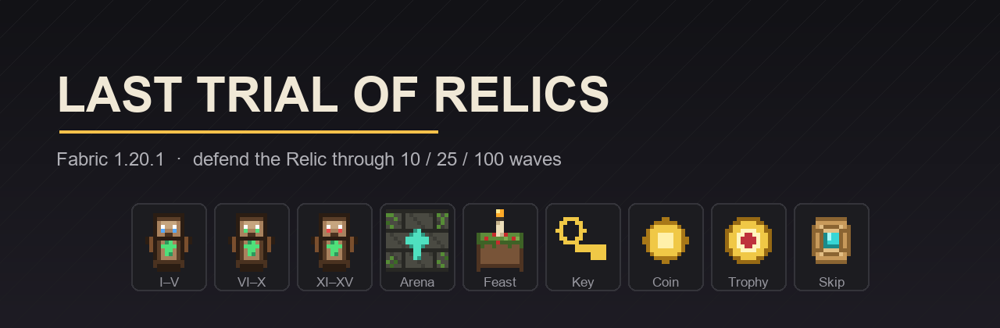

# Last Trial of Relics

[](https://github.com/kalirsa24/Last-Trial-of-Relics/actions/workflows/build.yml)
[](LICENSE)




Мод на защиту Реликвии: волны мобов идут к алтарю, ломают его и копают стены.
Игрок отбивается, тратит монеты в магазине и вкладывает персональные награды
в вечное древо навыков.

**Mod id:** `lasttrial` · **Jar:** `last_trial_of_relics-0.3.0.jar` · **Java:** 17

---

## Возможности

- **Три Реликвии** — 10, 25 и 100 волн, с разной прочностью, сложностью и ассортиментом магазина.
- **Волны из этапов** — каждый этап получает долю бюджета волны, мобы выходят ручейком, этап закрывается по зачистке или таймауту.
- **Осада, а не таг-игра** — мобы выбирают ближайшую цель (игрок или алтарь), а застряв у стены, прокапывают проход.
- **Пять типов мобов** — шахтёр, лучник, крипер арены, призыватель разорителей и босс финальной волны.
- **Арена** — обязательная платформа 20×20 сплошного пола; 30×30 даёт бонус к награде. В подсказке Реликвии видны проценты готовности.
- **Тотемы усиления** — 15 тиров, от +3% до +125% исходящего урона; работают как тотем бессмертия.
- **Магазин** — блоки, оружие, патроны, обвесы, наборы, еда, усиления, големы и вкладка «Настройки» с управлением волной.
- **Древо навыков** — `/lasttrial skill`, пять вечных ветвей за персональные награды.
- **Бонус присутствия** — 5 минут у арены без отлучек дольше 15 секунд дают ×2 к награде.
- **Серверные предохранители** — лимит одновременных забегов, потолок живых мобов, авто-закрытие забега на выгруженной арене.

## Установка

1. Minecraft **1.20.1** + **Fabric Loader 0.16.10+**.
2. [Fabric API](https://modrinth.com/mod/fabric-api) **0.92.12+1.20.1**.
3. Положите `last_trial_of_relics-0.3.0.jar` в папку `mods`.
4. TACZ **не обязателен** — без него мод работает, просто вкладки оружия пустые.

## Как играть

1. Постройте площадку из плитки арены: минимум **20×20** сплошного пола, сверху — открытое небо.
2. Поставьте **Реликвию** (ПКМ предметом). Если площадка мала, в чат придут проценты готовности.
3. ПКМ по блоку — старт испытания, Shift+ПКМ — магазин.
4. Отбивайте волны, тратьте монеты, после победы забирайте награды и вкладывайте их в древо.

Клавиша **V** — старт / следующая волна.

## Команды

Основная команда — `/lasttrial`, короткий алиас — `/ltor`.

### Игрокам

| Команда | Что делает |
|---|---|
| `/lasttrial start` | запустить испытание у Реликвии или вызвать следующую волну |
| `/lasttrial shop` | открыть магазин |
| `/lasttrial buy <id>` | купить товар по id без GUI |
| `/lasttrial skill` | открыть древо навыков |
| `/lasttrial role <tank\|dps\|support>` | выбрать роль |
| `/lasttrial lives` | сколько жизней осталось |
| `/lasttrial wave` | волна, этап, живые мобы и очередь |
| `/lasttrial arena info` | показать свою арену |
| `/lasttrial arena reset` | снять свою арену |
| `/lasttrial pickup` | забрать блок Реликвии в инвентарь |
| `/lasttrial help` | список команд |

### Операторам (permission level 2)

| Команда | Что делает |
|---|---|
| `/lasttrial stop` | остановить испытание и убрать мобов |
| `/lasttrial forcestart <basic\|greater\|eternal>` | запустить забег нужного тира |
| `/lasttrial wave info` | подробности текущей волны |
| `/lasttrial wave stage <n>` | перейти к этапу вручную |
| `/lasttrial wave spawn <моб> <n>` | заспавнить мобов вне очереди |
| `/lasttrial wave skip <n>` | пропустить N волн |
| `/lasttrial arena remove <ник>` | снять чужую арену |
| `/lasttrial admin waves <ник> <n>` | задать игроку своё число волн |
| `/lasttrial admin clearwaves <ник>` | сбросить персональное число волн |
| `/lasttrial shoplist` | текстовый список товаров |

## Конфигурация

Файл `config/lasttrial.json` создаётся при первом запуске. Все значения проверяются
и зажимаются в безопасные рамки.

| Поле | По умолчанию | Смысл |
|---|---|---|
| `stagesPerWave` | 3 | этапов в волне (1–8) |
| `dripTicks` | 10 | интервал выхода мобов, тики |
| `dripMinTicks` | 4 | минимальный интервал на поздних волнах |
| `stageTimeoutSeconds` | 12 | сколько этап ждёт зачистки |
| `stageTimeoutPerMobTicks` | 10 | надбавка к таймауту за моба |
| `stageShares` | `[0.25, 0.30, 0.45]` | доли бюджета волны по этапам |
| `flagEveryWaves` | 5 | каждая N-я волна — флаговая |
| `stageStatBonus` | 0.05 | прибавка к статам мобов за этап |
| `intermissionTicks` | 100 | пауза между волнами |
| `spawnRadiusMin` / `Max` | 15 / 25 | кольцо спавна вокруг алтаря |
| `spawnEffects` | true | партиклы и звук выхода моба |
| `announceEveryStage` | true | писать в чат о каждом этапе |
| `relicMissingGraceTicks` | 200 | сколько терпеть снятую Реликвию |
| `arenaUnloadStopSeconds` | 300 | авто-закрытие забега на выгруженной арене (0 — ждать вечно) |
| `maxActiveTrials` | 3 | сколько забегов сервер тянет одновременно |
| `damageRules` | true | правила урона мода; выключите при конфликте с другим модом |

## Совместимость

- **TACZ** — опционально. Каталог оружия, патронов и обвесов собирается из реестра
  `tacz` при открытии магазина; без мода вкладки просто пустые. Цена считается
  по типу ствола: пистолеты +10, автоматы и ПП +20, снайперки/дробовики/пулемёты
  и патроны ×2. Классификация идёт по id предмета — экзотические имена получат
  базовую цену без наценки.
- **Моды на урон и броню** — при конфликте отключите `damageRules` в конфиге,
  тогда мод не трогает урон вообще.
- **Датапаки** — составы волн можно задать в `data/<namespace>/lasttrial/waves.json`;
  файл перечитывается на `/reload`, кривой JSON не роняет сервер.

## Баланс

- **Тотемы:** 3 / 6 / 9 / 12 / 15 / 30 / 45 / 50 / 60 / 75 / 80 / 95 / 105 / 115 / 125 %.
  В «щите» учитываются только два лучших тотема, итоговый множитель урона ограничен ×5.
- **Реликвии в инвентаре:** −15 / −30 / −45% входящего урона, максимум 3 штуки, потолок −60%.
- **Мобы празднества** бьют игрока вполсилы — основной риск несёт алтарь, а не игрок.
- **Хард-режим:** 120 монет, монеты ×2, награды ×2, статы мобов ×1.5.
- **Древо:** после 20 вложенных наград все цены магазина ×1.2.

Числа вынесены в код осознанно: это основа геймплея, а не «настройка на глаз».
Правки баланса сопровождаются тестами (`EconomyTest`).

## Сборка

```bash
./gradlew build     # jar в build/libs/
./gradlew test      # юнит-тесты экономики и тиров
./gradlew runClient # тестовый клиент
```

JDK 17 подтягивается через **Gradle toolchain** — локальные пути и `JAVA_HOME`
не нужны. Если JDK 17 нет в системе, Gradle скачает его сам (foojay resolver).

## Структура проекта

```
src/main/java/io/github/kalirsa24/lasttrial/
├── core/      забег, волны, арена, экономика, магазин, навыки
├── entity/    мобы празднества
├── item/      тотемы, награды, ключ, пир, пропуск
├── block/     Реликвия и её блочная сущность
├── network/   пакеты магазина и древа
└── registry/  блоки, предметы, сущности, вкладка
src/client/java/.../client/   магазин, древо, подсказка арены
src/main/resources/           ассеты, локализация, лут, рецепты, волны
src/test/java/...             юнит-тесты
```

Подробное описание каждого файла — [`docs/ARCHITECTURE.md`](docs/ARCHITECTURE.md).
Разбор слабых мест и планов — [`docs/REVIEW.md`](docs/REVIEW.md).

## Известные ограничения

- Боевое поведение проверено вручную, автотестами покрыта только математика.
- Каталог TACZ — эвристика по id, а не официальное API мода.
- Бонус присутствия не сохраняется между перезапусками сервера.
- Старые сохранения с id `festival` несовместимы: мод переименован в `lasttrial`.

## Лицензия

[MIT](LICENSE) © 2026 kalirsa24. Можно использовать, форкать и публиковать
сборки при сохранении текста лицензии.
